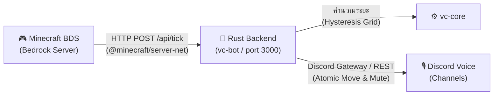

# 🎙️ Zircon VoiceChat v4.1 (Next-Gen Proximity System)

> ระบบเสียงตามระยะ (Proximity Voice Chat) ความเร็วสูง สำหรับ **Minecraft Bedrock Dedicated Server + Discord**  
> สถาปัตยกรรมใหม่ ขับเคลื่อนด้วย **Rust Backend (High Performance)** และ **Bedrock Script API**

[](https://github.com/ZXD44/VoiceChat-ZXD44)
[](https://www.minecraft.net/download/server/bedrock)
[](https://discord.com)

---

## 🌟 จุดเด่นและฟีเจอร์หลัก (Highlights)

* 🦀 **Rust High-Performance Core (`crates/vc-bot`, `crates/vc-core`)**:
  - พัฒนาด้วย **Rust 100%** ทรงพลัง ประสิทธิภาพสูง กินแรมต่ำ Latency ต่ำพิเศษ
  - อัลกอริทึมคำนวณระยะ Proximity Hysteresis ป้องกันการสลับห้องไปมาระหว่างเดินเฉียดกัน
* 🔗 **ระบบผูกบัญชี Discord สะดวก (`!link`)**:
  - ผู้เล่นพิมพ์ `!link <ชื่อในเกม>` ใน Discord ครั้งเดียวจบ (เช่น `!link Steve`)
  - **ไม่ต้องเปลี่ยนชื่อเล่น (Nickname) ใน Discord ให้ตรงกับเกมอีกต่อไป**
  - แอดมินสามารถพิมพ์ `!link @DiscordUser <ชื่อในเกม>` เพื่อผูกให้ผู้เล่นได้
* ⚡ **Atomic Move & Mute (ลดภาระ Discord API 60%)**:
  - จัดการย้ายห้องและสั่งเปิด/ปิดไมค์ใน Request เดียว ป้องกันไมค์แดงค้าง และแก้ปัญหาติด Discord Rate Limit 429
* 🛠️ **ปลดไมค์ฉุกเฉินได้จากในเกม (In-Game Unmute)**:
  - แก้ปัญหาไมค์ค้างได้ทันทีผ่านเมนูในเกม โดยไม่ต้องพับหน้าจอออกไปกดใน Discord
* 💬 **คำสั่งแชตเปิดเมนูทันใจ**:
  - พิมพ์ `!vc`, `!mic`, หรือ `!เสียง` ในช่องแชตเกมเพื่อเปิด UI ตั้งค่าได้ทันทีโดยไม่ต้องถือรีโมท
* 🧹 **Zero Ghost Channels**:
  - ตรวจสอบและเคลียร์ห้องเสียงอัตโนมัติ ลบห้องว่างทันทีเมื่อไม่มีคนใช้งาน หมดปัญหาห้องผีค้างใน Discord

---

## 🏗️ โครงสร้างสถาปัตยกรรม (Architecture)



```text
VoiceChat-ZXD44/
├── crates/
│   ├── vc-bot/               # Rust Discord Bot Worker & REST Server
│   └── vc-core/              # Proximity Grid Engine & Clustering Algorithm
├── docs/
│   ├── API.md                # REST API Documentation
│   ├── CONFIG.md             # คู่มือตัวแปร Environment ทั้งหมด
│   └── GAME-SETUP.md         # คู่มือการติดตั้งฝั่งเซิร์ฟเวอร์และแอดมิน
├── game/
│   ├── XVoice BP/            # Behavior Pack (Script API v1.14.0)
│   ├── XVoice RP/            # Resource Pack (Icon, UI, Textures)
│   └── permissions.example.json # ตัวอย่างสิทธิ์โมดูล BDS (@minecraft/server-net)
├── .gitignore
├── Cargo.lock
├── Cargo.toml                # Rust Workspace Manifest
├── config.env.example        # ตัวอย่างคอนฟิก
└── README.md
```

---

## ⚠️ ข้อกำหนดสำคัญก่อนเริ่มใช้งาน

| ✅ รองรับ | ❌ ไม่รองรับ |
| :--- | :--- |
| **Bedrock Dedicated Server (BDS)** (Windows / Linux) | Minecraft Realm |
| เซิร์ฟเวอร์คอมพิวเตอร์ที่เปิดสิทธิ์ `@minecraft/server-net` ได้ | Singleplayer / โลกเปิดเล่นคนเดียว |

> 📌 **หมายเหตุ:** ต้องเปิดสิทธิ์ใน `config/default/permissions.json` ของเซิร์ฟเวอร์ BDS เพื่ออนุญาตให้สคริปต์เชื่อมต่อ HTTP ออกไปหาบอทได้

---

## 🚀 วิธีการติดตั้งและเริ่มใช้งาน (Step-by-Step)

### 1️⃣ เตรียมฝั่ง Discord Bot (Rust Backend)
1. ติดตั้ง [Rust Toolchain](https://rustup.rs/) (หรือใช้ไฟล์คอมไพล์สำเร็จรูป)
2. คัดลอก `config.env.example` เป็น `config.env`:
   ```bash
   cp config.env.example config.env
   ```
3. กำหนดค่าใน `config.env`:
   ```env
   DISCORD_TOKEN=โทเคนบอทของคุณ
   GUILD_ID=ไอดีเซิร์ฟเวอร์ดิสคอร์ด
   LOBBY_CHANNEL_ID=ไอดีห้องล็อบบี้เสียง
   CATEGORY_ID=ไอดีหมวดหมู่ที่ต้องการให้บอทสร้างห้อง
   FIX_MIC_ID=ไอดีห้องแชตสำหรับปุ่มแก้ไมค์ค้าง
   API_SECRET=mcpe-voice-secret-zirconx
   PORT=3000
   ```
4. รันระบบบอท:
   ```bash
   cargo run -p vc-bot --release
   ```
5. ตรวจสอบสถานะการทำงาน:
   - เข้าเบราว์เซอร์ไปที่ `http://127.0.0.1:3000/api/health` ต้องตอบกลับ `{"status":"ok"}`

---

### 2️⃣ ติดตั้งฝั่ง Minecraft Server (BDS)
1. คัดลอกโฟลเดอร์แพ็กไปวางในเซิร์ฟเวอร์ BDS:
   - `game/XVoice BP` ➡️ วางใน `development_behavior_packs/` (หรือ `behavior_packs/`)
   - `game/XVoice RP` ➡️ วางใน `development_resource_packs/` (หรือ `resource_packs/`)
2. ใส่การอนุญาตในไฟล์ `config/default/permissions.json` ของโฟลเดอร์ BDS:
   ```json
   {
     "allowed_modules": [
       "@minecraft/server",
       "@minecraft/server-ui",
       "@minecraft/server-admin",
       "@minecraft/server-net"
     ]
   }
   ```
3. เปิดใช้งานแพ็กในโลก และเปิดฟังก์ชัน **Beta APIs** ในการตั้งค่าโลก
4. เริ่มรันเซิร์ฟเวอร์ BDS

---

## 💬 คำสั่งและการใช้งาน

### 📱 ในเซิร์ฟเวอร์ Discord:
- `!link <ชื่อในเกม>` : ผูกบัญชี Discord ของตัวเองกับตัวละครในเกม (เช่น `!link Steve`)
- `!link @ผู้ใช้ <ชื่อในเกม>` : *(สำหรับแอดมิน)* ผูกบัญชี Discord ให้กับผู้เล่นอื่น
- `!unlink` : ยกเลิกการผูกบัญชี
- กดปุ่ม **"ปลดไมค์ของฉัน"** ในห้อง `FIX_MIC_ID` เพื่อปลดไมค์ฉุกเฉินได้ตลอด 24 ชม.

### 🎮 ในเกม Minecraft:
- พิมพ์ `!vc`, `!mic`, หรือ `!เสียง` เพื่อเปิดแผงควบคุมระบบเสียง
- หรือถือไอเทม **"รีโมทดิสคอร์ด"** คลิกขวา (บนคอม) หรือกดค้าง (บนมือถือ)
- ปรับระยะการได้ยิน (5 - 10 บล็อก) และเลือกเอฟเฟกต์แสดงระยะรอบตัว
- **เมนูแอดมิน** (ต้องมีแท็ก `/tag @s add admin`): ปรับแต่ง URL บอท, API Secret, และสั่ง Sync ระบบ
